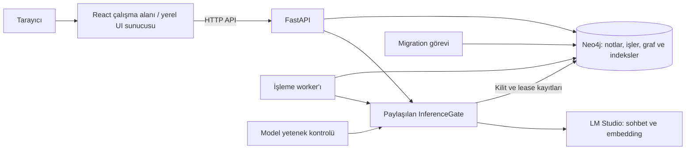

# GraphRAG — Eksikleri Tamamlama Mimarisi ve Yapılacaklar

### L — Qwen3.5, toplu yükleme ve referans graf (8 Kasım 2026)

- [x] Son görünüm isteği: gri zemin, büyük ana/küçük bağlı düğümler; soru kaynaklarını renkli, diğerlerini sönük gösterme ve vurguyu temizleme.

- [x] Çıkarım/cevabı yalnızca `qwen/qwen3.5-9b` ile çalıştırmak; başlatıcıyı ve model parmak izlerini güncellemek.
- [x] En fazla 50 karışık dosyayı tek seçimde yüklemek; dosya bazında hata, ilerleme ve çoğaltmayan tekrar denemek.
- [x] Açık zemin, mavi belge, kırmızı konu, gri varlık/seri düğümleri ve etiketli yönlü bağlantılar.
- [x] Kaynaklı ilişkileri ve dosya adından bölüm serilerini ayırmak; mevcut konu taşımasını korumak.
- [x] Gerçek model akışını, dokuz tarayıcı testini ve mevcut notların korunmasını doğrulamak; canlı sürümü açmak.

[Güncel kullanım, test kanıtları ve sınırlar](QWEN35_TOPLU_YUKLEME_VE_GRAF.md).
Aşağıdaki eski model ölçümleri yeni modelin genel doğruluk sertifikası değildir.

Tarih: 7 Kasım 2026  
Durum: **A–F yerel tek kullanıcı teslimi tamamlandı; ölçülen model kabulü geçti. G dış erişim koşullu kapsamdır.**

8 Kasım son teslim: A–F yerel tek kullanıcı kapsamı tamamlandı. D13/D14/D16 örnek kabulü geçti; genel model doğruluğu garantisi verilmez. Yeni 5 not/8 soru üzerinde iki tekrar ve üç yöntemle 48 istek tamamlandı: her yöntemde yanıtlanabilir 12/12, doğru çekimserlik 4/4, kaynak recall 1,000, hata 0. Arayüz ve kullanım sınırları [teslim raporundadır](TESLIM_RAPORU.md). G dış erişim koşullu ve kapsam dışıdır.

Bu belge, mevcut projeyi demo kullanımından kalıcı depolama ve gerçek yerel modellerle doğrulanmış kullanıma taşımak için hazırlanmıştır. Güncel uygulama ve ölçüm sonuçları [arayüz öncesi doğrulama raporunda](ARAYUZ_ONCESI_DOGRULAMA.md) bulunur. İlk inceleme aşağıda tarihsel kayıt olarak korunmuştur. A–D sonrasında kullanıcı arayüz referanslarıyla tasarım istedi ve ardından “uygula” talimatını verdi. Yeni React çalışma alanı [uygulama raporunda](ARAYUZ_UYGULAMA_RAPORU.md) belgelenmiştir.

## 1. İlk inceleme durumu (uygulama öncesi tarihsel kayıt)

| Konu | Bu oturumda elde edilen kanıt |
| --- | --- |
| Python ortamı | Python 3.12 ile kilit dosyasındaki bağımlılıklar `.venv` içine kuruldu. |
| Otomatik testler | 143 test geçti; Neo4j gerektiren 72 test atlandı. |
| Statik kontroller | Ruff, biçim kontrolü ve mypy başarılı. |
| Demo akışı | Gerçek HTTP üzerinden not ekleme, işleme, kaynaklı cevap, graf, güncelleme ve silme başarılı. |
| Arayüz | Streamlit ve bellek tabanlı demo API başlatıldı; sağlık uçları yanıt verdi. |
| Kalıcı çalışma | İlk incelemede Docker motoruna bağlanılamadı ve `.env` yoktu; bu oturumda Neo4j kurulumu yapılmadı. |
| Gerçek modeller | LM Studio ile gerçek sohbet ve embedding modeli doğrulanmadı. |
| Önceki raporlar | Repoda 215 başarılı test ve 28/28 hata senaryosu kaydı bulunuyor; bunlar önceki ortamın sonuçlarıdır. |

Sayfalama düzeltmesi: API'nin varsayılan sayfa boyutu 20'dir; `ui/api_client.py` açıkça `limit=50` gönderir. Arayüz `next_cursor` kullanmadığı için ilk **50** nottan sonrasına erişilemiyor. Önceki konuşmadaki “ilk 20 not” ifadesi bu nedenle düzeltilmiştir.

Demo değerlendirmesi gerçek model başarısını ölçmez. Bu oturumdaki hibrit ve graf sonuçlarında 11 yanıtlanabilir sorunun 10'unda gerekli kaynaklar bulundu; 5 yanıtlanamaz sorunun 4'ünde doğru biçimde cevap vermekten kaçınıldı. Bu sonuçlar canlı kalite hedefi olarak kullanılmayacaktır.

## 2. Hedef ve kapsam

Hedef: Windows üzerinde tekrar kurulabilen, verisini Neo4j'de saklayan, yerel LM Studio modelleriyle çalışan ve sonuçları ölçülmüş tek kullanıcılı bir not asistanı.

İlk teslimatta:

- Mevcut FastAPI, worker ve GraphRAG yapısı kullanılacak; onaylanan E tasarımıyla ana arayüz React çalışma alanına taşındı, Streamlit alternatif olarak korundu.
- Windows için kurulum, başlatma, durdurma ve teşhis adımları sağlanacak.
- Demo, kalıcı demo ve gerçek model kullanımı açıkça ayrılacak.
- Gerçek model bağlantısı, cevap kalitesi ve hedef makinedeki performans ölçülecek.
- Arayüz sayfalaması ve durum gösterimi tamamlanacak.
- Dış erişim için ayrı bir kimlik doğrulama ve ağ yapılandırması tanımlanacak.

İlk plan yeni frontend öngörmüyordu; kullanıcı referanslarıyla hazırlanan tasarım ve sonraki “uygula” talimatı React frontend'i kapsama aldı. İlk teslimden sonra kullanıcı PDF, Word ve Excel yükleme istedi; metin katmanlı `.pdf`, `.docx`, `.xlsx` ve `.xls`, UTF-8 `.txt`/`.md` yanında kapsama alındı. Otomatik OCR, eski `.doc`, çok kullanıcılı veri ayrımı, otomatik model indirme, Kubernetes ve birden fazla worker ile kapasite artırımı kapsam dışındadır. [Belge yükleme sınırları ve doğrulama](BELGE_YUKLEME.md).

## 3. Hedef mimari

`InferenceGate` mevcut uygulama içi bileşendir; yeni bir ağ servisi kurulmayacaktır. API ve worker aynı Neo4j üzerindeki aynı model sunucusu kimliğiyle bu kilidi paylaşır.

### 3.1 Bileşenlerin sorumlulukları

| Bileşen | Sorumluluk | Çalışma yeri |
| --- | --- | --- |
| React çalışma alanı | Not yönetimi, konular, soru-cevap, kaynaklar ve graf | Yerel statik/proxy sunucusu veya Nginx UI container'ı |
| FastAPI | Girdi doğrulama, not/iş API'si, arama ve cevaplama | Yerel Python veya container |
| Worker | İş kuyruğu, parçalama, çıkarım, embedding, yayınlama ve bakım | Kalıcı kullanımda ayrı süreç/container |
| Neo4j | Kalıcı notlar, revizyonlar, işler, varlıklar, ilişkiler ve indeksler | Ayrılmış Docker volume |
| LM Studio | Seçilen modellerin sunulması | Ana makine; Compose tarafından kurulmaz |
| Migration | Şema ve indeks kurulumları, boyut uyumluluğu | Başlangıçta tek seferlik görev |
| Değerlendirme aracı | Aynı uygulama bileşenleriyle kontrollü veri üzerinde ölçüm | Ayrı değerlendirme ortamı |

### 3.2 Çalışma modları

| Mod | Veri deposu | Sağlayıcı | Amaç |
| --- | --- | --- | --- |
| Bellek demosu | MemoryStore | DemoChat / FakeEmbeddings | Hızlı arayüz denemesi; süreç kapanınca veri kaybolur. |
| Kalıcı demo | Neo4j, ayrı demo volume'u | DemoChat / FakeEmbeddings | Model gerektirmeden kalıcılık ve servis akışını doğrulama. |
| Yerel gerçek kullanım | Neo4j, gerçek kullanım volume'u | LM Studio | Günlük kullanım ve gerçek model doğrulaması. |
| Canlı değerlendirme | Ayrı Neo4j container/volume'u | LM Studio | Kullanıcının notlarına dokunmadan kalite ölçümü. |

Demo embedding boyutu 64'tür. Gerçek modelin boyutu ölçülerek ayarlanır; mevcut 1024 varsayılanı otomatik olarak doğru kabul edilmez. Demo ve gerçek kullanım aynı vektör indeksini paylaşmaz. Model/profil değişiminde yeniden indeksleme planlanır; indeksin yalnızca boyutu değiştirilmez.

### 3.3 Yapılandırma ve bağlantılar

- `.env.example`, gerekli anahtarları ve açıklamaları içerir; gerçek değerler git dışında tutulan yerel yapılandırmada saklanır.
- Model kimlikleri LM Studio'nun gerçekten sunduğu kimliklerden seçilir. Kullanılacak modeller ve donanım kapasitesi uygulama aşamasında belirlenir.
- Ana makinede çalışan süreçler Neo4j ve LM Studio'ya yerel adreslerinden bağlanır.
- Container içindeki API/worker, Neo4j'ye servis adıyla, ana makinedeki LM Studio'ya `host.docker.internal` üzerinden bağlanır.
- UI container'ının `API_BASE_URL` değeri `http://api:8000` olur; tarayıcı arayüze `http://localhost:8501` üzerinden girer.
- Mevcut `.env.example` içindeki `127.0.0.1` model adreslerinin Compose varsayılanını geçersiz kılabilmesi giderilir. Yerel ve Compose adresleri ayrı değişkenlerle veya açık ortam dosyalarıyla tanımlanır.
- Compose ortam aktarımı gözden geçirilir: model bağlamı, token bütçeleri, model sunucusu kimliği, çalışma alanı ve ayrı embedding anahtarı gibi kullanılan ayarlar API, worker ve probe arasında tutarlı taşınır.
- Parolalar ve anahtarlar teşhis çıktılarında maskelenir; not içerikleri normal çalışma loglarına yazılmaz.

### 3.4 Başlangıç ve sağlık akışı

1. Python, bağımlılıklar, Docker erişimi, portlar ve yapılandırma kontrol edilir.
2. Neo4j başlatılır ve sağlıklı olması beklenir.
3. Migration çalışır; şema ve embedding boyutu doğrulanır.
4. Gerçek kullanımda model yetenek kontrolü API/worker ile aynı bağlantı ayarları ve paylaşılan inference kilidi üzerinden çalıştırılıp kaydedilir.
5. API, worker ve UI başlatılır; API readiness, worker heartbeat ve UI health birlikte doğrulanır.
6. Oluşturduğu test notlarını temizleyen smoke testi çalıştırılır.

Liveness, readiness ve worker'ın çalışıyor olması ayrı durumlar olarak gösterilir. Mevcut `/health/ready` worker heartbeat'ini kontrol etmez; başlatma denetimi bunu ayrıca kontrol etmelidir. Probe kaydı süresi dolduğunda yenileme adımı görünür olmalıdır. UI, API hazır olmadığında sorunu gösterebilmeli; başlatma bağımlılıkları bunu engellememelidir.

## 4. Uygulama sırası ve yapılacaklar

A–D ve onaylanan tasarıma göre E ilk dilimi uygulandı; F test ve belgeleri tamamlandı. E için ayrı React frontend seçildi; eski Streamlit kaynakları alternatif olarak korundu. İşaretler uygulamanın tamamlandığını belirtir; model kalitesinin tüm hedefleri geçtiği anlamına gelmez. Dış erişim istenirse G tamamlanmadan servisler dış ağa açılmaz.

### A — Windows kurulumu ve teşhis

Amaç: Temiz bir PowerShell oturumunda aynı kurulumu tekrar üretebilmek.

- [x] A1. Python 3.12 ve `uv` ön koşullarını, PATH ve `.venv` kullanımını belgelemek.
- [x] A2. Kilit dosyasından kurulum yapan `scripts/setup.ps1` hazırlamak; mevcut `.env` dosyasını ezmemek ve eksik ayarları açıklamak.
- [x] A3. `scripts/doctor.py` hazırlamak: yapılandırma, port çakışması, Docker, Neo4j, model erişimi ve servis durumu. Varsayılan teşhis salt okunur olmalı; migration veya veri silme yapmamalı.
- [x] A4. `scripts/start.ps1` ve `scripts/stop.ps1` hazırlamak. Mod açık seçilmeli; yalnızca bu projeye ait süreçler yönetilmeli, sahiplik tokenı, heartbeat ve log dosyaları `reports/runtime/` altında tutulmalı.
- [x] A5. Tekrar başlatmanın ikinci bir API/worker oluşturmamasını sağlamak. Durdurma Neo4j volume'unu silmemeli.
- [x] A6. Wheelhouse hazırlama işini platformdan bağımsız Python betiğine taşımak; Bash ve PowerShell girişleri aynı mantığı çağırmalı. Docker için Linux/Python 3.12 wheel hedefleri korunmalı.
- [x] A7. README ve işletim dokümanına doğrulanmış Windows adımlarını eklemek.

**Kabul ölçütü:** Temiz terminalden kurulum ve demo başlatma başarılı; eksik Python, port çakışması ve kapalı Docker anlaşılır hata üretir. İkinci başlatma servisleri çoğaltmaz; durdurma başka projelerin süreçlerine veya kalıcı veriye dokunmaz.

### B — Kalıcı Neo4j ve arayüzün Compose'a eklenmesi

- [x] B1. Kalıcı demo ve gerçek kullanım için ayrı Compose proje/volume adları tanımlamak.
- [x] B2. UI için ayrı Docker build target'ı ve Compose servisi eklemek. API/worker imajına gereksiz UI bağımlılıkları yüklememek.
- [x] B3. UI target'ında `ui/` kaynaklarını ve Streamlit ayarlarını kopyalamak; `.dockerignore` izinlerini güncellemek. Mevcut uygulama wheel'i yalnızca `src/notes_graphrag` paketini içeriyor.
- [x] B4. UI bağımlılıklarını da `uv.lock` üzerinden wheelhouse'a dahil etmek. Mevcut `notes-graphrag` entrypoint'ini UI target'ında Streamlit komutuyla değiştirmek.
- [x] B5. Yerel/Compose bağlantı ayarlarını 3.3 bölümüne göre ayırmak. UI portunu varsayılan olarak `127.0.0.1:8501` üzerinde yayınlamak.
- [x] B6. Başlatma sırası, migration başarısızlığı, API erişilemezliği ve worker durumu için görünür kontroller eklemek.
- [x] B7. Not ekledikten sonra servisleri yeniden başlatıp not, revizyon, kaynak ve grafın korunduğunu doğrulamak.
- [x] B8. Yedekleme/geri yükleme için PowerShell girişi veya doğrulanmış Windows çalışma yöntemi eklemek; geri yüklemeyi ayrı geçici hedefte denemek.

**Kabul ölçütü:** UI dahil servisler belgelenmiş tek başlatma akışıyla açılır. Kalıcı demo yeniden başlatılınca verisini korur. Migration/boyut uyuşmazlığı anlaşılır biçimde durdurur. Yedekten geri dönen not ve graf örneği doğrulanır.

Mevcut bellek demosundaki notların taşınması otomatik varsayılmayacaktır. Uygulama aşamasında korunması gereken notlar varsa API üzerinden dışa aktarma ve kontrollü yeniden içe alma ayrıca planlanır; kaynak süreç daha önce kapatılmaz.

### C — Gerçek LM Studio ve model doğrulaması

- [x] C1. Hedef GPU/VRAM, RAM, LM Studio sürümü, model kimlikleri, quantization ve bağlam uzunluğunu kaydetmek. Model dosyası indirme kararı bu bilgilerle verilmeli.
- [x] C2. Sohbet ve embedding modellerini yapılandırmak; gerçek embedding boyutunu ölçmek ve indeksle karşılaştırmak.
- [x] C3. Probe'u container dahil gerçek çağıran ortamdan çalıştırmak; yalnızca ana makineden erişimin yeterli sayılmamasını sağlamak.
- [x] C4. Ayrı `ANSWER_MODEL` seçildiğinde bu modelin de sohbet ve structured output kabiliyetini sınamak. Mevcut structured output denemesi yalnızca extraction modelini çağırıyor.
- [x] C5. Ayrı embedding endpoint'i kullanıldığında probe'un doğru sağlayıcıyı ve kimlik bilgisini kullanmasını sağlamak; mevcut uygulama wiring'iyle tutarlı hale getirmek.
- [x] C6. Probe fingerprint'ini endpoint/instance ve sonucu etkileyen ayarları kapsayacak biçimde gözden geçirmek. Gizli anahtar değerlerini fingerprint raporuna koymamak.
- [x] C7. Türkçe/İngilizce notlarla oluşturma, değiştirme, silme, kaynak doğrulama ve iki adımlı ilişki sorgusunu gerçek modelde çalıştırmak.
- [x] C8. Model kapalı, yanlış model adı, yanlış boyut, geçersiz token, kesilmiş JSON ve timeout durumlarını sınamak. Gerçek modda demo sağlayıcıya sessiz geri dönüş olmamalı.
- [x] C9. API ve worker eşzamanlı trafik alırken inference kilidini, timeout sonrası toparlanmayı ve worker yeniden başlatmayı doğrulamak.
- [x] C10. Sonuçları tarih, commit ve model profiliyle bir canlı doğrulama raporuna kaydetmek.

**Kabul ölçütü:** Seçilen gerçek modellerle probe ve HTTP smoke başarılı; eksik/yanlış yapılandırma hazır sayılmaz. API ile worker aynı model sunucusunda kontrollü çalışır. Türkçe/İngilizce örneklerde alıntıların kaynak aralıkları doğrudur. Model kalitesinin yeterliliği ayrıca D'de ölçülür.

C8 sınırı: Gerçek LM Studio üzerinde timeout, model/boyut ve kesilmiş çıktı sınandı. Token reddi yalnızca HTTP simülatöründe sınandı; yerel sunucunun kimlik doğrulaması kapalıdır.

### D — Canlı değerlendirme ve kalite ölçümü

- [x] D1. `scripts/evaluate.py` için gerçekten çalışan `--live` seçeneğini eklemek. Mevcut açıklama bu seçenekten söz ediyor, ancak parser ve sağlayıcı kurulumu yalnızca demo destekliyor.
- [x] D2. Sağlayıcı/depo kurulumunu uygulamadaki ortak wiring üzerinden yapmak; canlı değerlendirme inference kilidini atlamamalı.
- [x] D3. Değerlendirmeyi ayrı Neo4j container/volume'unda çalıştırmak; açık hedef kontrolü olmadan veritabanı temizlememek. Kullanıcı notlarının bulunduğu depo test hedefi olamaz.
- [x] D4. Ayrı depoların inference kilidini paylaşmadığını dikkate almak: canlı değerlendirme sırasında aynı LM Studio'yu kullanan normal uygulama trafiğini durdurmak veya ayrı model sunucusu kullanmak.
- [x] D5. Notları bir kez işleyip aynı değişmez veri üzerinde `vector`, `hybrid` ve `graph` yöntemlerini karşılaştırmak; model çıkarımındaki farklılıklar yöntem karşılaştırmasını bozmamalı.
- [x] D6. Mevcut 9 not/16 soru kümesini başlangıç kontrolü olarak korumak; Türkçe, İngilizce, olumsuzluk, çelişki, eş adlı varlık, iki adımlı ilişki ve yanıtsız soru örnekleriyle genişletmek.
- [x] D7. Geliştirme ve son doğrulama kümelerini ayırmak. İlgililik eşiğini aynı küçük veri kümesinde ayarlayıp başarı ilan etmemek.
- [x] D8. Kanıt bulma, cevaplanamaz soruda çekimserlik, çıkarılan ilişki doğruluğu ve cevabın kaynakça desteklenmesini ayrı ölçmek. Geçerli alıntı ofsetini tek başına doğru cevap kabul etmemek.
- [x] D9. Arama süresi, uçtan uca cevap süresi, ingestion süresi ve inference bekleme süresini ayrı ölçmek. Mevcut betiğin iki kez retrieval çağırmasının ölçümleri etkilemesini gidermek veya açıkça ayrı raporlamak.
- [x] D10. Soğuk/sıcak çalıştırmaları ayırmak; tekrar sayısı, hata/timeout sayısı, p50/p95, tepe VRAM ve RAM bilgilerini kaydetmek. Ölçülemeyen donanım değerini açıkça belirtmek.
- [x] D11. JSON ve okunabilir Markdown raporuna veri kümesi sürümü/hash'i, commit, model/profil, prompt sürümü, ayarlar ve soru bazlı sonuçları eklemek; UTF-8 çıktı kullanmak.
- [x] D12. İlk ölçümden sonra kalite ve gecikme eşiklerini yazılı olarak belirlemek; sonraki geliştirmeleri ayrılmış doğrulama kümesinde değerlendirmek.

**Kabul ölçütü:** `--live` gerçek modellerle tamamlanır ve tekrarlanabilir rapor üretir; demo ve canlı sonuçlar açıkça etiketlidir. Çıktılarda bozuk kaynak aralığı bulunmaz. Yanlış cevap ve başarısızlıklar rapordan çıkarılmaz. Kalite yeterliliği, önceden belirlenmiş eşiklerle ayrıca karara bağlanır.

D sonucu: Ölçüm altyapısı tamamlandı. Başlangıç kümesinde 7/9 not işlendi, recall 0,864; graf çekimserliği 4/5. Doğrulama kümesinde 6/6 not ve sayısal eşikler başarılıdır; anlamsal incelemede belirsizlik etiketi ve vektör cevap kaynak zinciri eksikleri vardır. Genel kalite onayı verilmedi. D10 ilk geçiş ve sıcak tekrarları ayırır; modeller önceden yüklü olduğundan ilk geçiş gerçek model yükleme soğuğu değildir. D8 ajan incelemesi yapıldı; bağımsız insan incelemesi bekler.

### D devamı — Kaynak ve model kalitesini iyileştirme

Kullanıcının ana plana göre devam talimatıyla bu dilime geçildi. Önceki doğrulama sonuçları artık hata analizi için incelendiğinden yeni bir ayrılmış kontrol kümesi de kullanılacak. G dış erişim hâlâ koşulludur.

- [x] D13. Başarısız Türkçe çıkarımları gerçek modelde yeniden üretmek; varlık sınırları/türleri ve onarım yönergesini düzeltmek. Hatalı çıkarımı sessizce boş sonuca çevirmemek. 8 Kasım: ilişki merkezli şemayla başlangıç 9/9; iki sorunlu örnek iki tekrarda da geçti. Yeni kümedeki Türkçe ekli proje/olumsuzluk da doğru çıktı.
- [x] D14. Olası ilişki ile kesin planı ayırmak; gelecekte olmasının tek başına `PLANNED` sayılmamasını sağlamak. 8 Kasım: önceki `h04` iki tekrarda PLANNED; yeni ayrılmış plan/olasılık ilişkileri doğru etiketlendi.
- [x] D15. Çok adımlı cevapların kaynak zincirini denetlemek; eksik halkada sınırlı yeniden üretim istemek. Graf kenarından açılan kaynağı aynı değişmez revizyona bağlamak.
- [x] D16. Soruya uygunluk, doğru çekimserlik, olumlu dil soruları ve olumsuzluk/çelişki korunması geliştirildi. Önceki sorunlar regresyon kümesinde geçti; son ayrılmış kümede üç yöntemde 12/12 cevap ve 4/4 doğru çekimserlik. Aynı modelin yorumuna ilişkin belirsizlik kullanıcıya gösterilir; kabul ölçülen yerel kapsamla sınırlıdır.
- [x] D17. Başlangıç kümesinde geliştirme, önceki doğrulamada regresyon ve yeni ayrılmış kümede son ölçüm yapmak. Veriyi/eşikleri başarıya göre değiştirmemek; hata ve gecikmeleri saklamak.
- [x] D18. Gerekli otomatik kontrolleri çalıştırmak, canlı servisi son sürümle açmak ve ana ilerleme durumunu kanıtlarıyla güncellemek.

8 Kasım son teslim: A–F yerel tek kullanıcı kapsamı tamamlandı. D13/D14/D16 örnek kabulü geçti; genel model doğruluğu garantisi verilmez. Yeni 5 not/8 soru üzerinde iki tekrar ve üç yöntemle 48 istek tamamlandı: her yöntemde yanıtlanabilir 12/12, doğru çekimserlik 4/4, kaynak recall 1,000, hata 0. Arayüz ve kullanım sınırları [teslim raporundadır](TESLIM_RAPORU.md). G dış erişim koşullu ve kapsam dışıdır.

### E — Arayüz eksikleri

- [x] E1. Mevcut cursor API'sini kullanarak “Önceki / Sonraki” gezinmesini eklemek; cursor geçmişini yeni React çalışma alanının durumunda tutmak.
- [x] E2. Filtre değişiminde cursor geçmişini sıfırlamak; silme sonrası son sayfa boşsa geri dönmek. Yeni notun panelini açmak ve verileri yenilemek.
- [x] E3. 0, 1, 50, 51 ve 101 notla gezinmeyi sınamak; sabit veri kümesinde notlar atlanmamalı veya yinelenmemeli.
- [x] E4. Demo/gerçek model ve geçici/kalıcı depolama bilgisini arayüzde görünür yapmak.
- [x] E5. System ekranında API, Neo4j, worker ve model durumunu anlaşılır göstermek. Readiness 503 olduğunda diğer durum bilgilerini göstermeye devam etmek.
- [x] E6. Graf ve kaynak okuma çağrılarındaki API hatalarını kullanıcıya anlaşılır göstermek; tek hata tüm ekranı kesmemeli.
- [x] E7. Yeni ana arayüzde Cytoscape.js ve lisans bildirimlerini yerel paketlemek; dış asset isteği olmadan graf çizimini doğrulamak. Eski Streamlit bileşeni alternatif kaynak olarak korunur.

**Kabul ölçütü:** 101 notun tamamı arayüzden ulaşılabilir. Depolama ve model modu görünür. API/model kesintisi anlamlı durum mesajı verir. Paketler ve modeller hazır olduğunda graf çizimi internet bağlantısı gerektirmez.

### F — Test, dokümantasyon ve teslim

- [x] F1. Değişen davranışlar için hedefli testler eklemek: sayfalama, sağlayıcı seçimi, probe kapsamı, yapılandırma ayrımı ve canlı değerlendirme wiring'i.
- [x] F2. Mevcut lint, format, tip ve test kontrollerini çalıştırmak; Neo4j testlerini yalnızca ayrılmış geçici veritabanında çalıştırmak.
- [x] F3. Windows kurulum/demoyu CI'da veya belgelenmiş temiz Windows ortamında doğrulamak; mevcut Linux/Neo4j doğrulamasını korumak.
- [x] F4. Gerçek modele ihtiyaç duyan testleri ayrı işaretlemek; normal CI için zorunlu GPU/model indirme bağımlılığı oluşturmamak.
- [x] F5. README, `docs/operations.md`, `docs/DEVELOPMENT_PLAN.md` ve `evaluation/README.md` içindeki komutları ve durum beyanlarını güncellemek.
- [x] F6. Repoda bulunmayan eski mimari belgesine yapılan başvuruları açıklığa kavuşturmak; bu belgeyi tamamlayıcı plan olarak bağlamak, eski kararların tümünü içerdiği iddiasında bulunmamak.
- [x] F7. Teslim raporuna geçen/atlanan/başarısız test sayılarını, çalışma ortamını, canlı model raporunu ve açık kalan işleri eklemek.

**Kabul ölçütü:** Güncel talimatlar uygulanarak aynı çalışma ortamı kurulabilir. Test atlamaları açıklanır. “Çalışıyor” beyanı hangi depo ve sağlayıcıyla doğrulandığını içerir.

### G — Dış erişim için kimlik doğrulama (koşullu)

Yerel tek kullanıcılı kurulumun varsayılanı loopback erişimidir. Ağdan kullanım açılacaksa bu aşama zorunludur; çok kullanıcılı yetkilendirme bunun ayrı bir devam çalışmasıdır.

- [ ] G1. React/Nginx arayüzünü kimlik doğrulamalı HTTPS reverse proxy arkasına almak. Eski Streamlit alternatifi de dışarı açılacaksa WebSocket bağlantılarını aynı oturum kontrolünden geçirmek.
- [ ] G2. API ve Neo4j portlarını dış ağa yayınlamamak. UI reverse proxy'sinin API çağrıları için ortamdan alınan servis token'ı kullanmak; servis token'ı tarayıcıya gönderilmemeli.
- [ ] G3. API'deki veri ve sistem uçlarını token doğrulamasına dahil etmek; sağlık uçlarının erişim kapsamını açıkça tanımlamak.
- [ ] G4. Proxy oturum yönetimi, çıkış, token yenileme ve hatalı kimlik bilgisi davranışını belgelemek; sırları repoya koymamak.
- [ ] G5. Proxy atlama, doğrudan API erişimi ve yanlış/eksik token senaryolarını sınamak; Streamlit açılacaksa oturumsuz WebSocket erişimini de sınamak.

**Kabul ölçütü:** Oturumsuz istemci arayüze/notlara ulaşamaz; dışarıdan doğrudan API veya Neo4j erişimi yoktur. Servis token'ı tarayıcı içeriğinde ve loglarda görünmez. Çok kullanıcılı veri izolasyonu sağlandığı iddia edilmez.

## 5. Dosya bazında değişiklik haritası

Bu tablo etki alanını gösterir. A–F ilk dilim oluşturuldu/güncellendi. Ana UI artık `frontend/`; dış erişim satırı beklemektedir.

| Dosya/alan | Planlanan değişiklik |
| --- | --- |
| `scripts/setup.ps1`, `start.ps1`, `stop.ps1`, `doctor.py` | Yeni Windows kurulum, servis yönetimi ve teşhis araçları |
| `scripts/build_wheelhouse.sh` ve yeni ortak Python betiği | Kilitli, API/UI ayrımlı ve Windows'tan çalışabilen build hazırlığı |
| `Dockerfile`, `.dockerignore`, `compose.yaml` | UI target/servisi, dosya paketleme, ortam aktarımı ve sağlık kontrolleri |
| `.env.example`, `core/config.py` | Yerel/Compose ayarları, eksik yapılandırma doğrulaması |
| `api/dependencies.py`, `providers/capability_probes.py`, `cli.py` | Sağlayıcı wiring'i ve gerçek model/probe kapsamı |
| `scripts/evaluate.py`, `evaluation/` | Canlı mod, ayrılmış veri ve ölçüm raporları |
| `frontend/`, `api/routes/workspace.py`, `persistence/workspace.py`, migration 005 | Yeni graf çalışma alanı, konu metadata'sı, arama, sayfalama ve kaynaklı cevaplar; eski `ui/` korunur |
| `tests/`, `.github/workflows/` | Değişikliklere uygun davranış testleri ve platform doğrulaması |
| `docs/`, `README.md` | Kurulum, mimari bağlantıları, ölçümler ve güncel durum |
| Ayrı proxy yapılandırması ve API auth bileşeni | Yalnızca G aşamasında dış erişim |

`core/`, `api/` ve `providers/` yolları `src/notes_graphrag/` altındadır. Mevcut şema ilk aşamada kullanılacaktır; ek şema ihtiyacı doğarsa yeni numaralı migration eklenir, uygulanmış migration dosyaları değiştirilmez.

## 6. Tamamlanma kontrolü

- [x] Windows'ta belgelenmiş kurulum ve servis yönetimi doğrulandı.
- [x] Neo4j yeniden başlatmada notları koruyor; yedek geri yükleme denendi.
- [x] UI Compose ile açılıyor; 50 kaydın ötesine erişiliyor.
- [x] Gerçek LM Studio probe ve smoke başarılı.
- [x] Türkçe/İngilizce canlı değerlendirme ve donanım raporu kaydedildi.
- [x] Kalite/performans eşikleri belirlendi ve sonuçları açıkça raporlandı.
- [x] İlgili otomatik testler başarılı; atlanan kontroller gerekçeleriyle listelendi.
- [x] Dış erişim istenmişse G tamamlandı; istenmemişse yerel erişim kapsamı belgelendi.

## 7. Sonraki kararlar

- Güncel profil: Qwen3.5-9B Q4_K_M (8192 bağlam) ve Nomic Embed Text v1.5 (768 boyut); RTX 4060 Laptop 8 GB. Yeni model kontrolü L kapsamı raporunda; önceki kalite ölçümleri eski profile aittir.
- Mevcut demo notları dışa aktarılarak korundu; kalıcı ortama taşıma kapsamı ayrıca belirlenecek.
- Kullanımın yalnızca bu bilgisayarda mı, ağ üzerinden mi olacağı.
- İlk canlı ölçümden sonra kabul edilecek cevap kalitesi ve gecikme eşikleri.

**Güncel durum:** 8 Kasım son teslim: A–F yerel tek kullanıcı kapsamı tamamlandı. D13/D14/D16 örnek kabulü geçti; genel model doğruluğu garantisi verilmez. Yeni 5 not/8 soru üzerinde iki tekrar ve üç yöntemle 48 istek tamamlandı: her yöntemde yanıtlanabilir 12/12, doğru çekimserlik 4/4, kaynak recall 1,000, hata 0. Arayüz ve kullanım sınırları [teslim raporundadır](TESLIM_RAPORU.md). G dış erişim koşullu ve kapsam dışıdır.

### Kullanıcı ek kapsamı — PDF ve Word

- [x] H1. Metin katmanlı PDF ve Word (.docx) dosyalarını yerelde düz metne çevirmek; boyut/sayfa/arşiv/zaman sınırları ve anlaşılır hata mesajları eklemek.
- [x] H2. Salt okunur önizleme ile kaydetmeden önce metni göstermek ve düzenlenmesine izin vermek; mevcut revizyon/kaynak akışına bağlamak.
- [x] H3. Türkçe, tablo/bağlantı, kaynak alıntısı, idempotency, bozuk/şifreli/taranmış/aşırı büyük dosyaları ve gerçek API tarayıcı akışını sınamak.
- [x] H4. Çalışan yerel API/worker/UI sürümünü güncellemek, gerçek modelle her iki biçimi doğrulamak ve yükleme sınırlarını belgelemek.

### Kullanıcı ek kapsamı — Excel

- [x] I1. `.xlsx` ve `.xls` sayfalarını/hücrelerini kaynak metne çevirmek; koordinat, Türkçe, tarih/saat, yüzde ve para biçimlerini korumak.
- [x] I2. Formülleri çalıştırmadan kayıtlı sonuçları ve eksik sonuçları açıklamak; gizli verilerin dahil olduğunu görünür kılmak.
- [x] I3. Önizleme/yükleme sınırlarını, kaynak alıntılarını ve gerçek API tarayıcı akışını sınamak; canlı sürümü güncellemek.

### Kullanıcı ek kapsamı — Tek tık başlatma

- [x] J1. `BASLAT.cmd` ile Docker, yerel modeller/sunucu ve proje servislerini hazırlamak; hazır olunca tarayıcıyı açmak.
- [x] J2. Açık servisleri kullanmak, bilgisayar yeniden açılınca durmuş proje servislerini veri silmeden başlatmak ve çökmeden kalan kilit dosyasının başlatmayı engellemesini önlemek.
- [x] J3. `DURDUR.cmd` ile yalnızca proje servislerini durdurmak; modeli/veriyi korumak ve başlangıç/hata akışlarını doğrulamak.

### Kullanıcı ek kapsamı — Konu düğümleri ve taşıma

- [x] K1. Yeni notları yapılandırılmış dosya adı ön ekine göre mevcut/yeni konu düğümüne atamak; manuel seçimi korumak.
- [x] K2. Listede sürükle-bırak hedefleri ve klavye/mobil konu seçimi eklemek; çakışmada üzerine yazmamak ve atamayı kalıcı tutmak.
- [x] K3. Mevcut KVKK/BDDK notlarını kaynaklarını ve işlerini değiştirmeden ayırmak; iki depo, tarayıcı ve canlı görünümle doğrulamak. [Sonuçlar](KONU_GRUPLAMA_VE_TASIMA.md).
